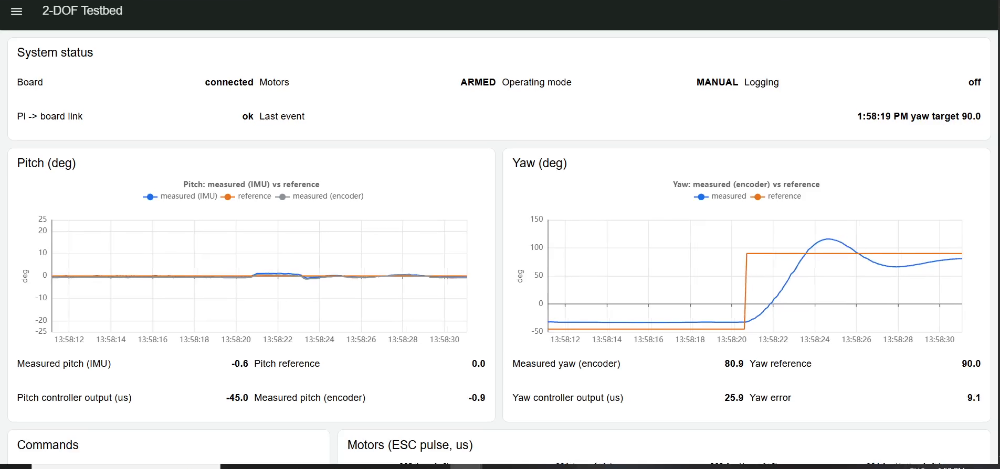
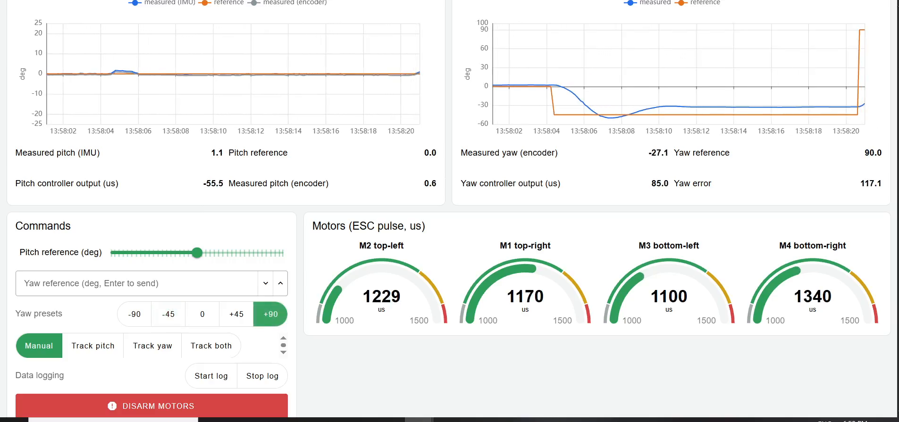
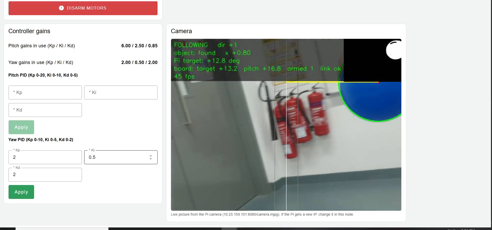
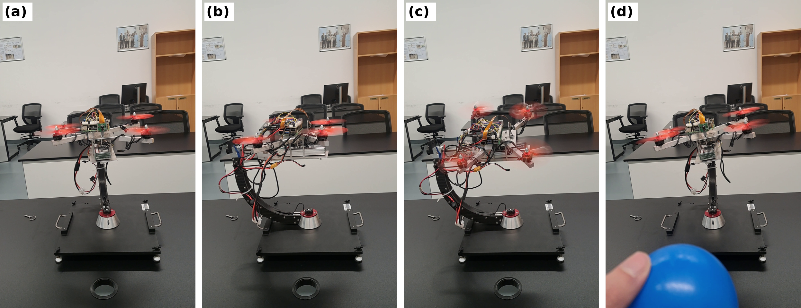

# 2DOF Drone Testbed

Shared repo for a 2-DOF drone testbed on the Hiwonder ROS Robot Controller (STM32F407).

| Folder | What goes there | Owner |
|---|---|---|
| `firmware/` | STM32CubeIDE project for the board | both |
| `ai/piml/` | Physics-informed ML | Zakaria |
| `ai/deepc/` | DeepC (data-driven predictive control) | Amr |
| `sim/` | Simulator: runs the board firmware on a PC with a simulated testbed ([how to use](sim/README.md)) | both |
| `docs/` | Reports, figures, notes | both |

Try the simulator: on Windows double-click `sim/start_simulator.bat`, or run `python -m testbed_sim --gui` in the `sim` folder.

Board pin map, flashing and team rules: [docs/PROJECT_NOTES.md](docs/PROJECT_NOTES.md). Board datasheets: [docs/datasheets](docs/datasheets). Testbed parts (motors, encoders, ESC): [docs/hardware](docs/hardware). Hiwonder lessons: [docs/hiwonder-tutorials](docs/hiwonder-tutorials).

Final MTR520 submission (report, setup and operation guide, demo results): [docs/final-report](docs/final-report). The demo videos are kept outside the repo (too large).

## Final demo (MTR520)

Live Node-RED dashboard with the real rig: status, pitch and yaw charts.

Commands, motor gauges, gains and camera tracking:

The rig during the demo:

More screenshots and results: [docs/final-report/README.md](docs/final-report/README.md).

New to Git? Read [docs/GIT_TUTORIAL.md](docs/GIT_TUTORIAL.md) first (5 minutes). Prefer typing commands? See [docs/GIT_COMMANDS.md](docs/GIT_COMMANDS.md).
