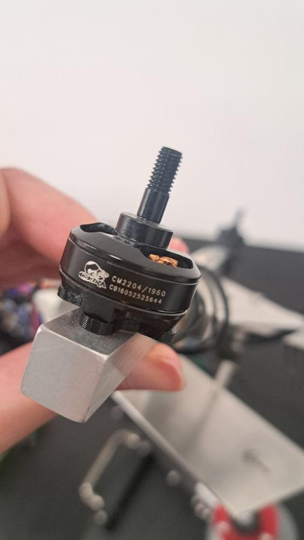
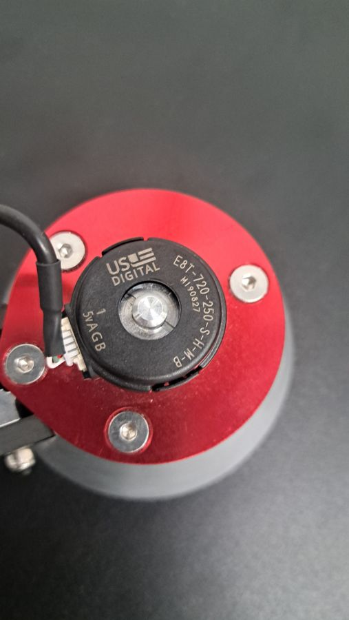
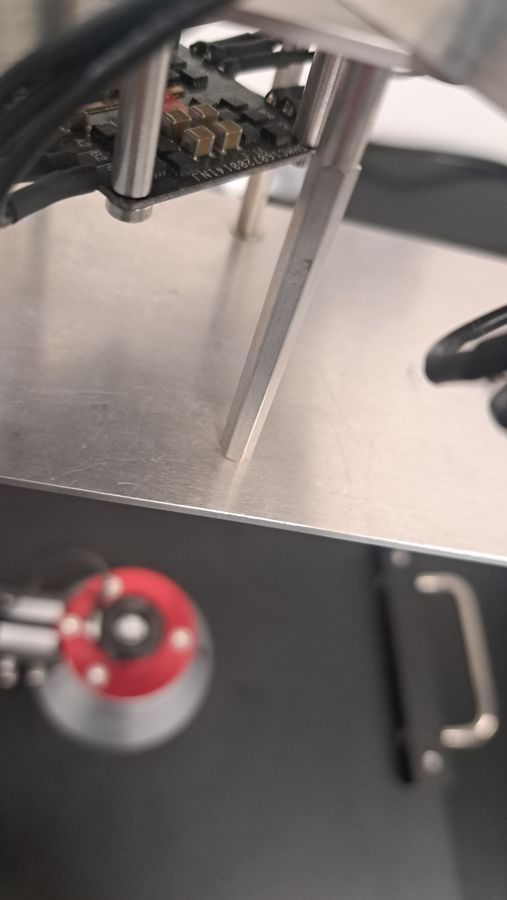

# Testbed parts

Parts identified from photos of the testbed (2026-10-20). Values marked *check* come from general knowledge of the part, not from a datasheet in this repo yet.

## Motors: Cobra CM2204/1960 (x4)

- Brushless outrunner, 2204 size (stator about 22 mm wide, 4 mm tall).
- **1960 KV**: about 1960 rpm per volt with no load, so roughly 23,500 rpm at 12 V.
- Threaded shaft with prop nut (prop direction set by the thread, *check* CW/CCW per motor).
- Datasheet: not in the repo yet. Look up "Cobra CM-2204/28 1960KV" on innov8tivedesigns.com (Cobra's maker).

## Joint encoders: US Digital E8T-720-250-S-H-M-B (x2)

- Optical incremental encoder kit, quadrature A/B output.
- **720 CPR** (cycles per revolution). In TIM encoder mode with both edges counted (x4) that is **2880 counts per revolution, 0.125° per count**.
- Shaft bore 0.250 in. Output *S* = single-ended (one wire per channel).
- **Runs on 5 V.** The label prints the connector pins as `5V A G B` starting at pin 1 (5 V, channel A, ground, channel B). This matches the board's encoder ports, which supply 5 V. The encoder pins we use (PA0, PA1, PA15, PB3) are 5 V tolerant on the STM32F407 (*check* in the datasheet pin table).
- Datasheet: E8T page on usdigital.com.

## ESC: 4-in-1, marked DMHC 160720014INJ (v1.1)

- One board drives all four motors. No datasheet found. We drive it at 400 Hz, 1000–2000 µs pulses (see `firmware/`).
